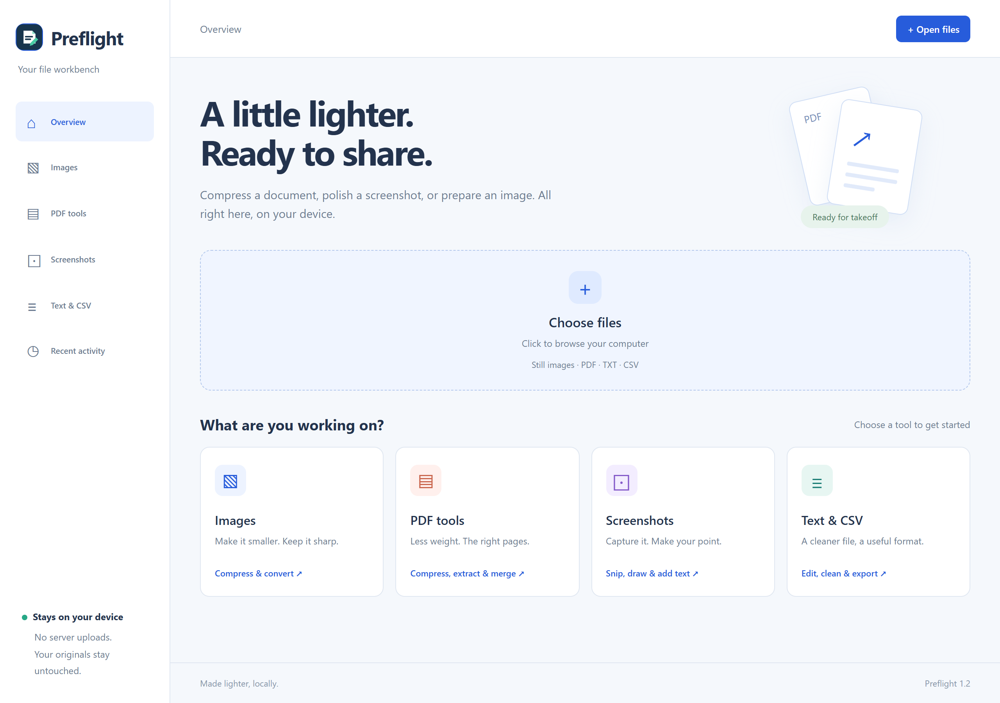

<p align="center"></p>

# Preflight

**Make your files lighter. Make your screenshots clearer. Keep processing on your device.**

A desktop browser extension for students, teachers and anyone preparing a PDF, image or screenshot before sharing. Choose your own compression goal, inspect the measured result, and upload only when you decide.

[Download v1.3.0](https://github.com/FutureAlok1445/Preflight-Lightweight-File-Review-Before-Upload/releases/latest) · [Student installation guide](INSTALL.md) · [Privacy](PRIVACY.md) · [Report a problem](https://github.com/FutureAlok1445/Preflight-Lightweight-File-Review-Before-Upload/issues)



## What you can do

| Tool | Useful options |
| --- | --- |
| PDF compression | Lossless, Balanced, Strong and Custom; desired reduction percentage or target MB; actual size before download; optional whole-page compression with consent. |
| PDF pages | Extract page ranges or merge multiple PDFs in your chosen order. |
| Images | Quality/strength slider, editable presets, JPEG/WebP/PNG output, resizing, target KB and batches. Compare original and encoded result. |
| Screenshots | Capture the visible page or manually choose an area. Move/resize the area, type editable text, draw, highlight, add shapes/arrows, crop, undo/redo, copy or save. |
| Text extraction | Local English or English + Hindi OCR. Extract → Copy, with language and TXT download under More. |
| Text and CSV | Edit UTF-8 text, clean whitespace, validate/convert CSV to JSON, and export Latin text to PDF. |
| Website review | Review a standard file selection before uploading. Keep the original, compress, download, or open the workspace. Explicit confirmation releases a file to the website. |

Everything needed at runtime is bundled. There is no remote compression server, login, subscription, or runtime CDN dependency.

## Install in five steps

1. Download the **Chromium ZIP** from [Releases](https://github.com/FutureAlok1445/Preflight-Lightweight-File-Review-Before-Upload/releases/latest).
2. Extract it to a folder you will keep.
3. Open `chrome://extensions` or `edge://extensions`.
4. Enable **Developer mode** → **Load unpacked** → select the folder containing `manifest.json`.
5. Pin Preflight → **Open file workbench**.

No build step, Node.js or npm installation is required to use it. After an update, reload the extension, refresh websites, and close/reopen the workspace. Manual installations do not auto-update.

For Firefox, use the separate package described below. For Brave, Opera/GX or Vivaldi, see [INSTALL.md](INSTALL.md).

## Browser support

| Browser | Package | Verification / limitations |
| --- | --- | --- |
| Chrome / Chromium desktop 121+ | Chromium | Full extension workflow checks in Chromium. |
| Microsoft Edge desktop | Chromium | Full checks against the installed Edge browser. |
| Firefox desktop 140+ | Firefox | Tested in Firefox 157: install, branding, workspace opening, image conversion, PDF target compression, background scan processing, offline OCR and website review. Requires site-access permission. |
| Brave, Opera/GX, Vivaldi desktop | Chromium | Uses shared Chromium APIs and a fallback processing tab when offscreen is unavailable. These browsers have not each been independently verified. |
| Safari | Separate Apple package required | Not packaged or verified on Windows. Do not install the Chromium ZIP as a Safari extension. |
| Mobile browsers | — | This release targets desktop; mobile Chrome and universal mobile support are not advertised. |

Firefox's generated ZIP is unsigned. **Permanent student installation requires Mozilla signing**, either an AMO listing or a signed XPI. Temporary loading through `about:debugging` lasts until Firefox restarts. It uses a background document/frame rather than a Chrome service worker/offscreen document.

## Compression that reports the real result

**Compression effort and bytes saved are different things.** Maximum effort does not mean every PDF loses 100% of its bytes. Files already containing efficient text, vectors or compressed images may shrink very little.

- Set **Desired size reduction** to your custom percentage, or type a **Target size** in MB. A 95% goal means an output at most 5% of the original size.
- After a short pause, the live result reports actual encoded bytes and whether your goal was reached. Image previews show the actual encoded quality too.
- Automatic PDF targets first optimize safely supported embedded images while retaining selectable text, vector graphics and editable forms.
- If that cannot reach your goal, you can explicitly allow **whole-page image compression**. It retains visible pages but removes selectable text, links, forms and bookmarks. Inspect small text before sharing.
- Automatic targets stop at a quality floor: JPEG quality at least 45%, image-edge cap at least 1200 px, and whole-page rendering at least 96 DPI. Those bounds do not guarantee that every tiny character remains readable.
- The original is kept if no smaller file is found. An unattainable target is reported honestly; there is no universal 80–95% savings guarantee.

### Faster target processing in v1.3.0

Target fitting loads a document once, reuses up to 32 MB of decoded original images across attempts, skips duplicate quality profiles and stops retrying unsupported images. Whole-page fitting renders each page once and encodes its bounded candidates from that surface. Changing settings cancels obsolete local PDF work. A current measured preview is reused when you press Compress instead of processing it again.

A local three-run paired benchmark, alternating old/new engines after warmup on the same 11.3 MB PNG-heavy PDF, reduced median processing time from **0.84 s to 0.47 s (about 45%)**, with the **same 733,500-byte output** and the same automatic quality floor. Document loads fell from four to one; image decodes from twelve to three. This was an engine benchmark, not a promise for every file/device or total upload time.

In a separate 2 MB target check, that PDF became **1.64 MB**, retaining selectable assignment text and its editable student form. A consented whole-page example became **5.04 MB → 0.50 MB**. Test fixtures are generated examples, not user documents.

### Manual PDF modes

| Mode | Behavior |
| --- | --- |
| Lossless | Object-stream rewrite without image-quality changes. |
| Balanced | Starting strength 35: quality 78%, longest embedded-image edge up to 2400 px. |
| Strong | Starting strength 65: quality 58%, edge up to 1600 px; strips common metadata. |
| Custom | Adjustable effort from 1–100; manual maximum uses quality 25%, edge up to 800 px. Text remains selectable in supported-image mode. |
| Smallest | Converts pages into images only after consent. Manual maximum uses quality 25%, up to 72 DPI and an 800 px edge; small text can blur. Automatic targets use the higher floor above. |

Safe image optimization supports simple 8-bit RGB/grayscale JPEG and raw/Flate streams. Masks, indexed/CMYK color, predictors and custom decode arrays remain untouched. The optional whole-page path handles visual page content that cannot be safely optimized as individual images. PDFs above 100 MB and password-protected PDFs are unsupported. Editing invalidates digital signatures.

## Image controls

Still PNG, JPEG, WebP, BMP, GIF and browser-decodable AVIF inputs are accepted; outputs are JPEG, WebP or PNG. Use custom 10–95% lossy quality, linked compression effort, dimensions and target size. PNG is lossless, so lossy quality controls are disabled. Target mode can lower quality and resize within a bounded search; it cannot guarantee every requested size.

Images are limited to 45 MB input and an 8000 px canvas edge. Studio/OCR limits its working input to 32 MP. Animated GIF/PNG/WebP/AVIF are kept unchanged to preserve frames. HEIC, TIFF, SVG and specialist codecs are not processed. JPEG flattens transparency onto white. Re-encoded images lose EXIF metadata. Pure compression retains the original below 8% savings; target mode can retain smaller savings. Explicit format conversion/resizing is kept even if it increases bytes, so review the result.

## Simple screenshot editing

Area selection waits for your next action; it never opens Studio or saves automatically. Move the selected area or resize its edge/corner handles before and after adding annotations. The compact toolbar stays beside it; extra tools and Full studio are under **More**.

Click **Text** to create a box immediately and type. Click outside, Escape or Ctrl+Enter to finish. Click an object directly to move it, resize its corner, or double-click text to edit again. There is no separate Select/move step. Pen, highlight, rectangle, ellipse, arrow, crop, duplication, deletion, layer order and undo/redo are available.

**Save PNG** and **Copy image** export the crop with annotations. **Apply edits** in the workspace retains the editable scene until another file opens. **Open workspace** from a web capture transfers a flattened PNG. Extract text shows a small result and Copy; it does not require the full editor sidebar. OCR can make mistakes.

Visible-page capture covers the current viewport, not an entire scrolling page. High-DPI exports preserve captured pixel resolution. Browser settings/store pages are restricted; local file URLs need browser permission.

## Website upload review

Supported file inputs show a local review card with the same custom controls and measured sizes. An image batch uses shared format/quality/resize settings. A detected website size limit can be used for automatic image fitting. A single PDF can use custom effort, desired reduction, target MB and consented whole-page compression. Website whole-page processing is limited to about 48 MB because of the browser message transfer limit; use the workspace for larger PDFs.

Nothing uploads simply because a preview finishes. You must choose **Continue with Original** or **Continue Upload**. Opening the workspace clears the held website selection; download the result and select it again when ready.

Site-size detection is a heuristic. Custom upload widgets, drag-and-drop, earlier website listeners, inaccessible shadow roots and restricted pages can bypass review. Unsupported types receive metadata review only, without compression/conversion or integrity-validation claims.

## Share with 100 students

**Free pilot:** share the [Release download](https://github.com/FutureAlok1445/Preflight-Lightweight-File-Review-Before-Upload/releases/latest) and [five-step student guide](INSTALL.md). Each computer processes files locally; no hosting or per-student payment is needed.

**Simpler ongoing rollout:** Microsoft Edge Add-ons has no developer registration fee and offers store installation/update delivery for Edge. Firefox supports Mozilla-reviewed/signed distribution. Chrome Web Store requires a one-time publisher registration fee; students install free. For a class using Chrome, an unlisted store listing is simpler than helping every student maintain an unpacked installation.

Store accounts, identity checks, signing/review and approval are separate from GitHub publication. This repository does not claim an approved store listing. See [INSTALL.md](INSTALL.md) for the comparison and official links.

## Privacy

No accounts, analytics, remote file processing or automatic upload. Original disk files are not overwritten. Preferences use extension-owned local storage. One pending file and one last image may be cached in extension-owned IndexedDB; expired records are discarded on their next access after one hour. This is not an in-memory-only or secure-erasure guarantee. See [PRIVACY.md](PRIVACY.md) for permissions and storage details.

## Development

Node.js 22.16+ (Node 24 used for checks) and Python 3 are needed for development/packaging, not installation.

```sh
npm ci
npm test
npx playwright install chromium
npm run check:browser
python scripts/package-extension.py
```

Builds land in ignored `dist/`: one Chromium ZIP and one Firefox ZIP, plus unpacked folders. Packaging includes only runtime directories and user docs; no tests, dependencies, personal files, logs or fixtures. Use a fresh build folder when changing the runtime allowlist.

To test an installed Edge executable, set `PREFLIGHT_BROWSER_PATH` before `npm run check:browser`. Firefox checks use `node scripts/firefox-check.mjs`, with `GECKODRIVER_PATH` and `FIREFOX_PATH` set to your tools. The Firefox script uses its own temporary browser session. Generate browser fixtures first, then run `node scripts/compression-benchmark.mjs` for a three-run target benchmark. `--before` and the paired `--compare` mode require an earlier engine snapshot at `output/processor-before.js`.

The checks cover real encoded downloads, text/form preservation, target misses, mask safety, scan consent, OCR, direct object editing, crop pixels, image batches, upload confirmation and responsive layout. Screenshots, generated fixtures and logs are ignored under `output/`. They do not contain student files.

```text
core/         File, image, PDF, text and annotation engines
popup/        Browser toolbar popup
optimizer/    File workbench
upload/       Website review and area capture
compression/  Local background processing document
icons/        Shared SVG mark and toolbar PNG sizes
lib/          Bundled PDF/OCR runtimes, models and licenses
scripts/      Browser checks, benchmark and package builder
```

## Dependencies and attribution

[pdf-lib](https://pdf-lib.js.org/) 1.17.1, [PDF.js](https://mozilla.github.io/pdf.js/) 6.4.299, [Tesseract.js](https://github.com/naptha/tesseract.js) 7.0.0 and English/Hindi [tessdata_fast](https://github.com/tesseract-ocr/tessdata_fast) are bundled locally. Their licenses and font/codec notices are retained under `lib/`. The PDF.js legacy build includes compatibility polyfills for older desktop browsers. Development versions are recorded in `package-lock.json`.

Preflight is an independent project, not affiliated with Canva, iLovePDF, Smallpdf, Google, Microsoft or Mozilla. No project-wide reuse license has been declared; bundled third-party assets retain their own licenses.
